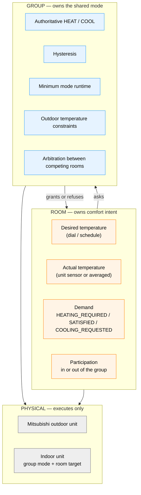
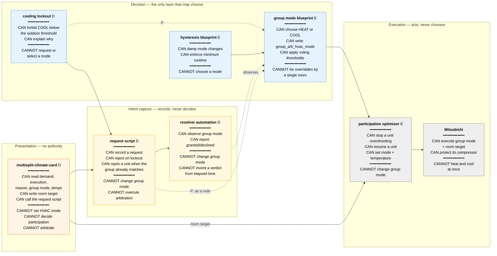
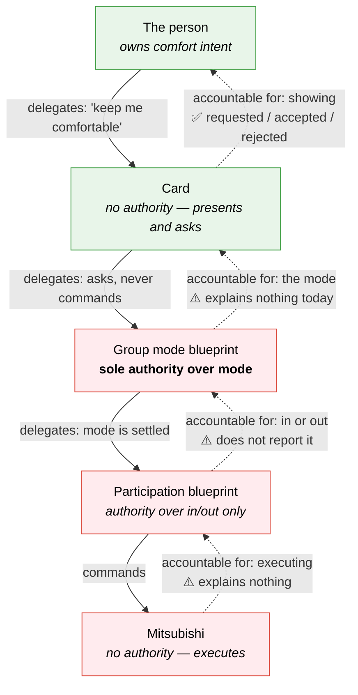
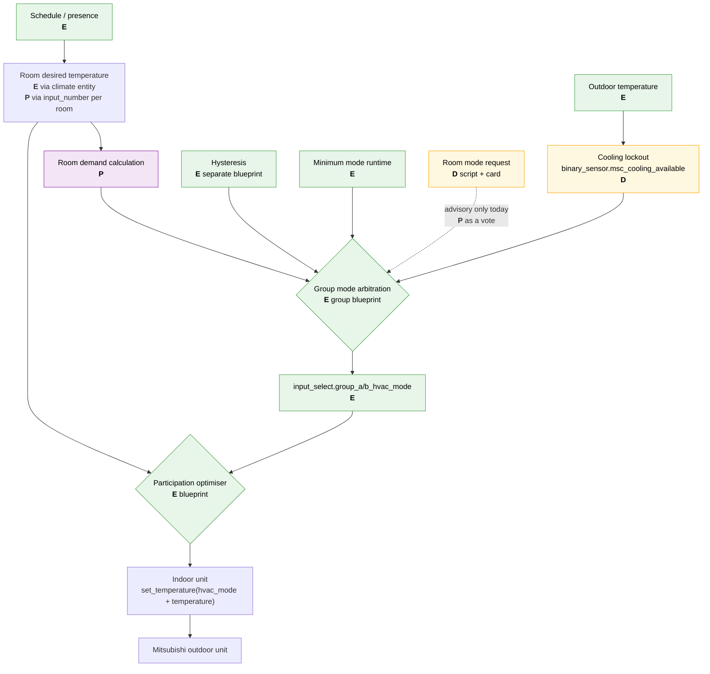
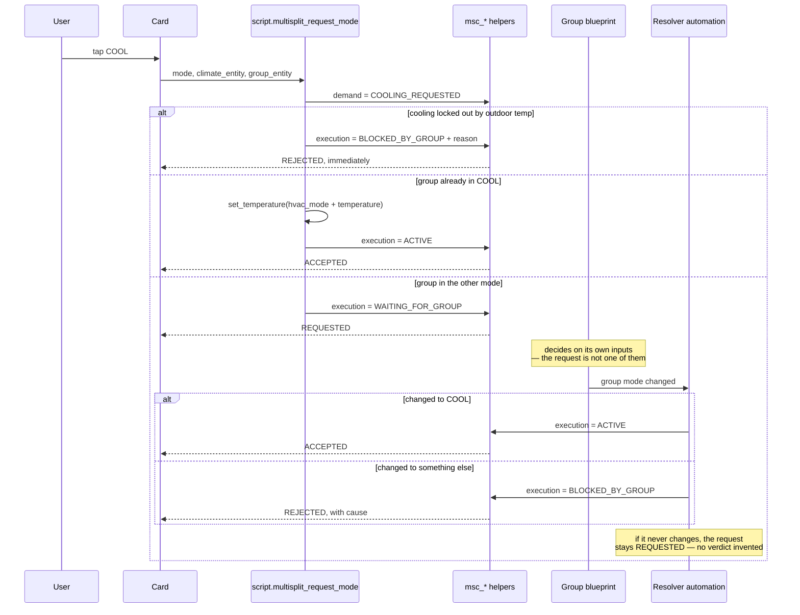

# Multi-split climate architecture

Status of every box below:

| Mark | Meaning |
| --- | --- |
| **E** | Exists today — your blueprints and helpers |
| **D** | Drafted in this repo, **never run against Home Assistant** |
| **P** | Proposed only — discussed, not built |

The governing rule (§19): **room autonomy ends at comfort intent. Shared HVAC
mode belongs to the multi-split group.**

---

## 1. Layers of authority

Who is allowed to decide what. Every defect we have hit traces back to a
decision being taken at the wrong layer.

A room may **ask** for a mode. It may never **set** one. That single
constraint is why the card has no mode selector and why the request flow
exists at all.

---

## 2. Component capabilities

What each part is *allowed* to do. The "cannot" column is the load-bearing
one — it is what keeps one room from disrupting every other room.

### Authority, ownership, accountability

Three different things, and each of our three real defects is a failure of a
different one:

- **Authority** — who may *decide*. Confusion here causes **thrashing**: two
  parties both think they may choose the mode.
- **Ownership** — who may *write* the state, and who you change to alter
  behaviour. Confusion here caused the **23°C Office**: three writers, no owner.
- **Accountability** — who must *explain* the outcome. Absence here is why a
  request can sit on **REQUESTED forever** with nothing able to say why.

| Concern | Authority — decides | Ownership — single writer | Accountability — explains |
| --- | --- | --- | --- |
| Group HEAT / COOL | group mode blueprint **E** | group blueprint → `group_a/b_hvac_mode` **E** | ⚠️ **nobody** — it decides silently (**P**: publish `last_evaluated` + cause) |
| Mode change damping | hysteresis blueprint **E** | hysteresis blueprint **E** | ⚠️ nobody — invisible to the user |
| Cooling permitted | outdoor lockout rule **D** | `input_number.msc_cool_lockout_below` **D** | ✅ `binary_sensor.msc_cooling_available` `reason` **D** |
| Room comfort target | the person, via dial or schedule | ⚠️ **split three ways** — card, schedule, participation blueprint | ✅ card displays it (but cannot reconcile the three) |
| Room participation | participation blueprint **E** | participation blueprint **E** | ⚠️ gap — it does not write `msc_*_execution`, so the card's ACTIVE/SLEEPING reflects only request outcomes |
| Room demand | demand calculation **P** | request script **D** | ✅ `msc_*_reason` **D** |
| Request outcome | group blueprint, implicitly | resolver automation **D** | 🟡 resolver *infers* from observed behaviour; it cannot see arbitration's reasoning |
| Physical execution | Mitsubishi firmware | Mitsubishi | ⚠️ opaque — compressor protection and changeover are unobservable (**P**: measure it) |

Solid arrows are **authority delegating downward**. Dotted arrows are
**accountability reporting back upward** — and three of the four are broken.
The card is accountable to the person and does its job; everything below it
decides without explaining, which is why the card can only ever report what it
can *infer*.

Closing the chain is one small, additive change per layer: each writes a
reason when it acts. That is the highest-value backend work available, and it
is strictly cheaper than the integration rewrite.

### Who may write what

One writer per piece of state. Two writers is how the 23°C defect happened.

| State | Written by | Read by |
| --- | --- | --- |
| `input_select.group_a/b_hvac_mode` | group blueprint **only** | card, script, resolver, participation |
| `binary_sensor.msc_cooling_available` | derived from outdoor temp | script, resolver, group blueprint (**P**) |
| `msc_*_demand` | request script | card |
| `msc_*_execution` | request script, resolver | card |
| `msc_*_reason` | request script, resolver | card |
| `climate.*` hvac_mode | participation blueprint; request script on rejoin only | — |
| `climate.*` target temperature | card, schedule, participation blueprint | card |

The last row is the one to watch: **three writers**, which is exactly the
condition that produced the 23°C Office. Collapsing it to a single room-target
helper per room (**P**, §18) removes the ambiguity.

---

## 3. Control flow

**The dotted line is the honest gap.** A request is recorded and watched, but
nothing feeds it into arbitration. Until the group blueprint accepts requests
as an input, asking for the opposite mode only succeeds if arbitration
independently decides to switch.

---

## 4. What a mode request actually does

Rejection is only ever reported on **evidence**: a lockout that forbids it, or
the group demonstrably moving elsewhere. Elapsed time never produces a
verdict, because hysteresis and minimum runtime live in separate blueprints
and a clock cannot distinguish "not considered yet" from "turned down".

---

## 5. Component inventory

| Component | Kind | Lives | Status |
| --- | --- | --- | --- |
| Group HVAC mode controller | blueprint | HA | **E** |
| Hysteresis | blueprint (separate) | HA | **E** |
| Participation optimiser | blueprint | HA | **E** |
| `input_select.group_a/b_hvac_mode` | helper | HA | **E** |
| Averaged room temperature (Living Room) | sensor | HA | **E** |
| `multisplit-climate-card.js` 2.1.0 | Lovelace card | `/config/www/` | **D** |
| `multisplit_requests.yaml` | package | `/config/packages/` | **D** |
| `binary_sensor.msc_cooling_available` | template | package | **D** |
| Request as an arbitration vote | blueprint input | — | **P** |
| Group publishing `last_evaluated` | blueprint output | — | **P** |
| Outdoor-temp-primary changeover | blueprint logic | — | **P** |
| Changeover duration measurement | automation | — | **P** |
| Heat lockout above a threshold | template | — | **P** |
| Custom integration | Python | `custom_components/` | **P** |

---

## 6. Known defects and gaps

| # | Issue | Where it belongs |
| --- | --- | --- |
| 1 | Unit resumes at its remembered setpoint (the 23°C Office) — mode restored without temperature | participation blueprint (**P**); the request script already pairs them (**D**) |
| 2 | Requests do not influence arbitration | group blueprint (**P**) |
| 3 | A request arbitration silently declines stays `REQUESTED` forever | needs the group to publish that it evaluated (**P**) |
| 4 | Mode thrashing when opposing rooms alternate participation | mitigated by outdoor lockout (**D**) and long minimum runtime (**E**) |
| 5 | Helper sprawl: six helpers per room | the reason to consider an integration (**P**) |
| 6 | Participation blueprint does not write `msc_*_execution`, so ACTIVE/SLEEPING reflects request outcomes, not real participation | participation blueprint (**P**) |
| 7 | No layer below the card explains itself (accountability chain broken) | one reason-write per blueprint (**P**) |

---

## 7. Why the card survives a backend rewrite

The card talks to a **contract**, not an implementation:

- reads three entities — demand, execution, reason
- reads one group mode helper
- calls one service with `mode`, `climate_entity`, `group_entity`
- writes the target via `climate.set_temperature` or an `input_number`

Whether those entities are `input_select` helpers or a custom integration's
sensors, the card is byte-identical. Only the entity ids in the dashboard
config change. That is why validating the model with YAML first costs
nothing if the backend is later rewritten in Python.
